# Mini-API de Catálogo → API de la Tienda (FastAPI)

Proyecto del curso de **APIs con FastAPI** (SENA, ADSO). Es **un solo repositorio que crece guía por guía**:
cada guía agrega funciones a la misma API y este README se actualiza con lo nuevo.

**Aprendices:** Manuela Córdoba Robledo y Davier Andrés Quinto Bejarano · Ficha 3229209 · ADSO (SENA)
**Instructor:** Mateo Arroyave

## Contenido

1. [Estado actual](#estado-actual-guía-3-seguridad)
2. [Historial por guías](#historial-por-guías)
3. [Historial de lo realizado](#historial-de-lo-realizado)
4. [Tecnologías y librerías](#tecnologías-y-librerías)
5. [Instalación y ejecución](#instalación)
6. [Estructura del proyecto](#estructura-del-proyecto)
7. [Usuarios de prueba](#usuarios-de-prueba)
8. [Endpoints y permisos](#endpoints-y-permisos)
9. [Cómo usar la seguridad](#cómo-usar-la-seguridad-en-docs)
10. [Ejemplos de respuestas](#ejemplos-de-respuestas)
11. [Códigos de respuesta](#códigos-de-respuesta)
12. [Problemas frecuentes](#problemas-frecuentes)
13. [Evidencias](#evidencias)
14. [Referencias](#referencias)

## Estado actual: Guía 3 (seguridad)

La API de la tienda tiene productos y categorías con CRUD completo, organizada en routers, y ahora está
**protegida**: login con JWT, contraseñas con hash (bcrypt) y permisos por rol (admin / cliente).
Los datos siguen en memoria; se conectarán a una base de datos en la Guía 4.

**Entregables de la Guía 3**

- Código: este repositorio (tag `guia-3`).
- Informe con las 4 evidencias: [docs/Guia3_FastAPI_Seguridad_3229209.docx](docs/Guia3_FastAPI_Seguridad_3229209.docx)

## Historial por guías

| Guía | Fecha del informe | Tema | Evidencia de producto | Documentación | Código |
|------|-------------------|------|-----------------------|---------------|--------|
| 1 | 6/11/2026 | Primeros pasos con FastAPI: mini-API de catálogo (solo lectura) | GA1-AA3-EV04 | [docs/guia-1.md](docs/guia-1.md) | tag `guia-1` |
| 2 | 13/11/2026 | CRUD con Pydantic y organización con `APIRouter` | GA2-AA3-EV04 | [docs/guia-2.md](docs/guia-2.md) | Repositorio [`tienda-api`](https://github.com/robledocordoba123-cmyk/tienda-api); su código quedó integrado aquí |
| 3 | Noviembre de 2026 | Seguridad: JWT, hashing y roles | GA3-AA3-EV04 | [docs/guia-3.md](docs/guia-3.md) | tag `guia-3` (y `main`) |

Para ver el código tal como estaba en una guía: `git checkout guia-1` (y `git checkout main` para volver).
El resumen técnico de cada cambio está en [CHANGELOG.md](CHANGELOG.md).

## Historial de lo realizado

Lo más reciente va primero. Cada guía parte de lo que dejó la anterior.

### Guía 3: seguridad de la API (noviembre de 2026)

**Punto de partida:** la API de la Guía 2 estaba abierta; cualquiera podía crear, modificar o borrar productos.

**Qué se hizo**

- [x] Reflexión sobre los riesgos de una API sin protección (GA3-AA1-EV01).
- [x] Cuadro y mapa conceptual: autenticación, autorización, hashing, JWT, login, rol, 401 y 403, con diagrama del flujo (GA3-AA1-EV02).
- [x] Módulo `seguridad.py`: hashing de contraseñas con bcrypt, tokens JWT que caducan a los 30 minutos y las dependencias `obtener_usuario_actual` (401) y `requerir_admin` (403).
- [x] Router `routers/auth.py`: `POST /auth/login`, `GET /auth/yo` y `POST /auth/registro` (siempre crea usuarios con rol `cliente`).
- [x] Protección de productos: POST y PUT piden token, DELETE pide rol admin, los GET siguen públicos (GA3-AA2-EV03).
- [x] Reto: las mismas reglas aplicadas al CRUD de categorías (GA3-AA3-EV04).
- [x] Pruebas en `/docs` con los usuarios `admin` y `ana`: 401, 201, 403 y 200 (capturas en [`capturas/guia-3`](capturas/guia-3/)).
- [x] Informe en Word y README actualizado.

**Resultado:** API pública para consultar, protegida para modificar y con permisos según el rol.
**Documentación:** [docs/guia-3.md](docs/guia-3.md) · **Versión:** tag `guia-3`.

### Guía 2: CRUD y organización de la API (13 de noviembre de 2026)

**Punto de partida:** una mini-API de solo lectura en un único `main.py`.

**Qué se hizo**

- [x] CRUD completo de productos y categorías (POST, PUT y DELETE además de los GET).
- [x] Modelos Pydantic (`ProductoEntrada`, `CategoriaEntrada`); el servidor asigna el id.
- [x] Organización con `APIRouter`: un archivo por recurso en `routers/`, conectados desde `main.py`.
- [x] Respuestas 404 cuando el recurso no existe y 422 cuando los datos son inválidos.
- [x] Los endpoints `/buscar` y `/categorias` (lista de nombres) de la Guía 1 se reemplazaron por el CRUD de categorías.

**Resultado:** API ordenada por recursos, pero **sin ninguna protección**.
**Entrega:** repositorio [`tienda-api`](https://github.com/robledocordoba123-cmyk/tienda-api) · **Documentación:** [docs/guia-2.md](docs/guia-2.md).

### Guía 1: mini-API de catálogo (6 de noviembre de 2026)

**Qué se hizo**

- [x] Primeros endpoints con FastAPI en un solo `main.py`: `/`, `/productos`, `/productos/{id}`, `/categorias` y `/buscar`.
- [x] Productos guardados en una lista en memoria.
- [x] Documentación automática en `/docs` y pruebas con *Try it out* (capturas en [`capturas/guia-1`](capturas/guia-1/)).

**Documentación:** [docs/guia-1.md](docs/guia-1.md) · **Versión:** tag `guia-1`.

**Commits de esta guía**

| Fecha | Commit | Cambio |
|-------|--------|--------|
| 30/10/2026 | `c06839c` | Mini-API de Catálogo con FastAPI (GA1-AA3-EV04) |
| 30/10/2026 | `1c036d4` | README: enlace del repositorio |
| 04/11/2026 | `a2f11b8` | README: integrantes del grupo |

<details>
<summary>Ejemplos de la Guía 1 (versión del tag <code>guia-1</code>)</summary>

```
GET /productos/2
→ {"id": 2, "nombre": "Mouse gamer", "precio": 85000, "categoria": "Perifericos"}

GET /productos/abc
→ 422, porque producto_id debe ser un entero

GET /categorias
→ ["Perifericos", "Pantallas"]

GET /buscar?nombre=mouse
→ [{"id": 2, "nombre": "Mouse gamer", "precio": 85000, "categoria": "Perifericos"}]
```

En la versión actual `GET /categorias` devuelve el CRUD de categorías (con id y nombre) y `/buscar` ya no existe.

</details>

### Próximo paso

- [ ] **Guía 4:** conectar la API a una base de datos real (hoy los datos viven en memoria).

### Cómo se actualiza este historial

En cada guía: agregar un bloque nuevo arriba de esta sección, una fila a la tabla de historial, el resumen en [CHANGELOG.md](CHANGELOG.md) y un tag `guia-N` al terminar.

## Tecnologías y librerías

| Herramienta | Para qué se usa |
|-------------|-----------------|
| **Python 3.10+** | Lenguaje del proyecto |
| **FastAPI** | Framework para construir la API y generar `/docs` |
| **Uvicorn** | Servidor que ejecuta la API |
| **Pydantic** | Validación de los datos de entrada (viene con FastAPI) |
| **bcrypt** | Hashing de contraseñas |
| **PyJWT** | Creación y validación de tokens JWT |
| **python-multipart** | Recibir el formulario de usuario y contraseña del login |

Se usa `bcrypt` directamente y no `passlib`, porque las versiones recientes de bcrypt tienen un conflicto conocido con passlib.

## Requisitos

- Python 3.10 o superior
- pip

## Instalación

1. Clonar el repositorio y entrar a la carpeta:

   ```bash
   git clone https://github.com/robledocordoba123-cmyk/mini-api-catalogo.git
   cd mini-api-catalogo
   ```

2. Crear el entorno virtual:

   ```bash
   python -m venv venv
   ```

3. Activarlo, según la terminal que uses:

   ```bash
   # Windows (CMD o PowerShell)
   venv\Scripts\activate

   # Windows (Git Bash o MSYS2)
   source venv/Scripts/activate

   # Linux / macOS / WSL
   source venv/bin/activate
   ```

   Cuando funciona, aparece `(venv)` al inicio de la línea.

4. Instalar las dependencias:

   ```bash
   pip install -r requirements.txt
   ```

## Ejecución

```bash
uvicorn main:app --reload
```

Si `uvicorn` no se reconoce, usa `python -m uvicorn main:app --reload`.

- Swagger UI: http://127.0.0.1:8000/docs
- ReDoc: http://127.0.0.1:8000/redoc

Si el puerto 8000 está ocupado: `uvicorn main:app --reload --port 8001`.
Para detener el servidor: `Ctrl + C`.

La clave con la que se firman los tokens se toma de la variable de entorno `SECRET_KEY`.
Si no existe se usa la clave de ejemplo de la guía (solo para desarrollo).

## Estructura del proyecto

```
mini-api-catalogo/
├── main.py              # crea la app y conecta los routers
├── seguridad.py         # hashing, usuarios, JWT y dependencias de protección
├── routers/
│   ├── __init__.py
│   ├── auth.py          # /auth: login, registro y /yo
│   ├── productos.py     # CRUD de productos
│   └── categorias.py    # CRUD de categorías
├── docs/                # documentación por guía, diagramas e informe
├── capturas/            # evidencias (guia-1, guia-2, guia-3)
├── requirements.txt
└── CHANGELOG.md
```

## Usuarios de prueba

| Usuario | Contraseña | Rol |
|---------|------------|-----|
| `admin` | `admin123` | admin |
| `ana` | `ana123` | cliente |

Las contraseñas se guardan hasheadas con bcrypt; estos son solo datos de prueba en memoria.
Los usuarios que se crean con `/auth/registro` también viven en memoria y se pierden al reiniciar el servidor.

## Endpoints y permisos

| Método | Ruta | Acceso | Descripción |
|--------|------|--------|-------------|
| GET | `/` | Público | Mensaje de bienvenida |
| POST | `/auth/login` | Público | Recibe usuario y contraseña (formulario) y devuelve el token |
| POST | `/auth/registro` | Público | Crea un usuario con rol `cliente` |
| GET | `/auth/yo` | Token | Devuelve el usuario dueño del token |
| GET | `/productos` | Público | Lista los productos |
| GET | `/productos/{id}` | Público | Un producto (404 si no existe) |
| POST | `/productos` | Token | Crea un producto (201) |
| PUT | `/productos/{id}` | Token | Actualiza un producto |
| DELETE | `/productos/{id}` | **Admin** | Elimina un producto |
| GET | `/categorias` | Público | Lista las categorías |
| GET | `/categorias/{id}` | Público | Una categoría (404 si no existe) |
| POST | `/categorias` | Token | Crea una categoría (201) |
| PUT | `/categorias/{id}` | Token | Actualiza una categoría |
| DELETE | `/categorias/{id}` | **Admin** | Elimina una categoría |

## Cómo usar la seguridad en `/docs`

1. Pulse **Authorize**, escriba `admin` / `admin123` (o `ana` / `ana123`) y confirme. Deje `client_id` y `client_secret` vacíos.
2. Los endpoints protegidos muestran un candado y ya envían el token.
3. **Logout** quita el token. Para cambiar de usuario: Authorize → Logout → entrar con el otro.

También con `curl`:

```bash
# 1. Obtener el token
curl -X POST http://127.0.0.1:8000/auth/login -d "username=ana&password=ana123"

# 2. Usarlo en una operación protegida
curl -X POST http://127.0.0.1:8000/productos \
  -H "Authorization: Bearer <TOKEN>" -H "Content-Type: application/json" \
  -d '{"nombre":"Audifonos","precio":50000,"categoria":"Audio"}'
```

## Ejemplos de respuestas

**Login correcto** (`POST /auth/login`, 200)

```json
{"access_token": "eyJhbGciOiJIUzI1NiIs...", "token_type": "bearer"}
```

**Login con contraseña incorrecta** (401)

```json
{"detail": "Usuario o contrasena incorrectos"}
```

**Registro de un usuario** (`POST /auth/registro`, 201)

```json
{"mensaje": "Usuario registrado", "username": "davier", "rol": "cliente"}
```

**Registro de un usuario que ya existe** (400)

```json
{"detail": "El usuario ya existe"}
```

**Quién soy** (`GET /auth/yo` con token, 200)

```json
{"username": "ana", "rol": "cliente"}
```

**Crear un producto con token** (`POST /productos`, 201)

```json
{"mensaje": "Producto creado", "producto": {"id": 4, "nombre": "Audifonos", "precio": 50000.0, "categoria": "Audio"}, "creado_por": "ana"}
```

**Actualizar un producto con token** (`PUT /productos/2`, 200)

```json
{"mensaje": "Producto actualizado", "producto": {"id": 2, "nombre": "Mouse gamer", "precio": 90000.0, "categoria": "Perifericos"}, "actualizado_por": "ana"}
```

**Sin token** (401)

```json
{"detail": "Not authenticated"}
```

**Token inválido o vencido** (401)

```json
{"detail": "Token invalido"}
```

**Un cliente intenta borrar** (403)

```json
{"detail": "Requiere rol de administrador"}
```

**Recurso que no existe** (`GET /productos/99`, 404)

```json
{"detail": "Producto no encontrado"}
```

**Dato con tipo incorrecto** (`GET /productos/abc`, 422)

```json
{"detail": [{"type": "int_parsing", "loc": ["path", "producto_id"], "msg": "Input should be a valid integer, unable to parse string as an integer", "input": "abc"}]}
```

## Códigos de respuesta

| Código | Cuándo ocurre |
|--------|---------------|
| 200 / 201 | Operación correcta / recurso creado |
| 400 | El usuario que se intenta registrar ya existe |
| 401 | Falta el token, es inválido o expiró; o login con datos incorrectos |
| 403 | Está autenticado, pero no es administrador |
| 404 | El producto o la categoría no existe |
| 422 | Datos inválidos (tipo incorrecto o campo faltante) |

El token JWT caduca a los 30 minutos.

## Problemas frecuentes

| Problema | Causa y solución |
|----------|------------------|
| `bash: venv\Scripts\activate: command not found` | En Git Bash la barra `\` no sirve. Usa `source venv/Scripts/activate` |
| `source: venv/Scripts/activate: No such file or directory` | El entorno no existe en esa carpeta. Crea uno con `python -m venv venv` |
| `uvicorn: command not found` | El entorno no está activado o falta instalar. Activa `venv` y ejecuta `pip install -r requirements.txt`, o usa `python -m uvicorn main:app --reload` |
| 404 al abrir `/docs.` | La dirección tiene un punto al final. Usa `http://127.0.0.1:8000/docs` |
| Puerto 8000 ocupado | Usa `uvicorn main:app --reload --port 8001` |
| 401 estando logueado en `/docs` | El token caduca a los 30 minutos. Pulsa Authorize → Logout y entra de nuevo |
| El usuario registrado o los productos creados desaparecen | Los datos viven en memoria y `--reload` los reinicia al guardar un archivo |
| Las capturas no se ven en GitHub | Deben estar en `capturas/guia-3/` (sin subcarpetas), con el mismo nombre y extensión que usa el README, y haber pasado por `git add`, `commit` y `push` |

## Evidencias

Las capturas de cada guía están en [`capturas/`](capturas/):

- [`capturas/guia-1`](capturas/guia-1/): endpoints de lectura del catálogo.
- [`capturas/guia-2`](capturas/guia-2/): CRUD de productos y categorías (entregadas en `tienda-api`).
- [`capturas/guia-3`](capturas/guia-3/): pruebas de seguridad (401, 201, 403, 200).

### Guía 3: pruebas de seguridad

| Prueba | Captura |
|--------|---------|
| Botón Authorize y candados | 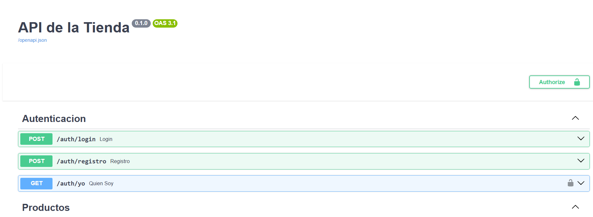 |
| Authorize como admin | 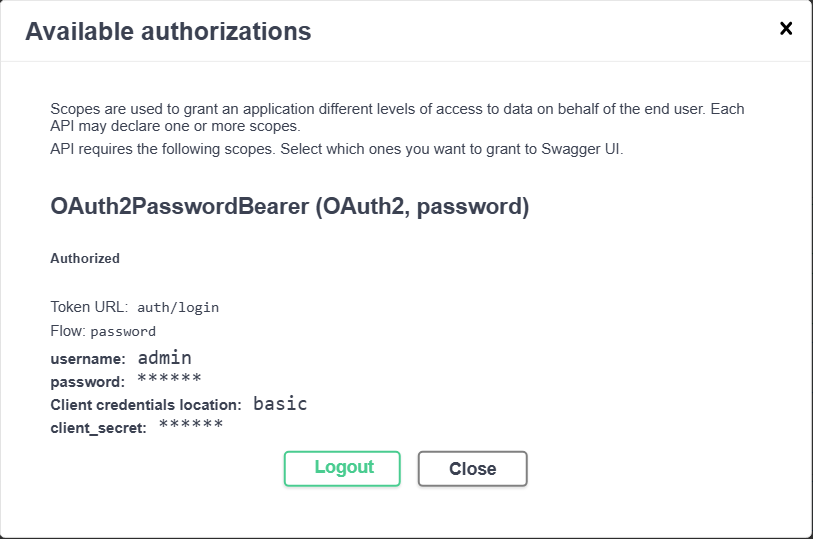 |
| ana crea un producto (201, `creado_por: ana`) | 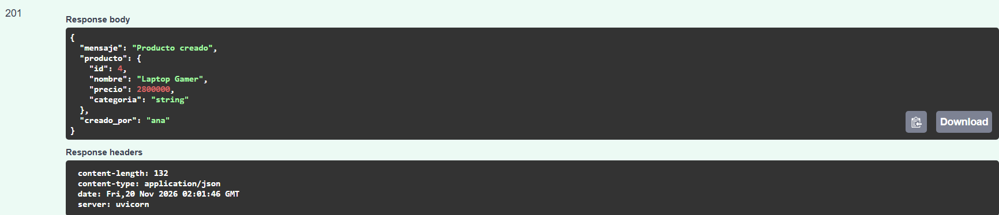 |
| POST /productos sin token (401) | 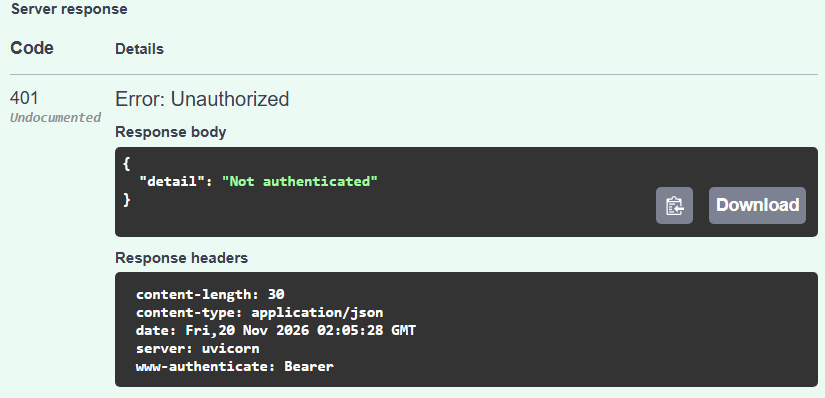 |
| ana intenta borrar un producto (403) | 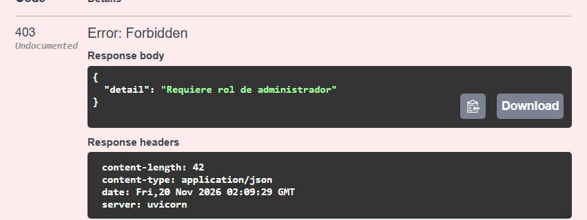 |
| Inicio de sesión con contraseña incorrecta (401) | 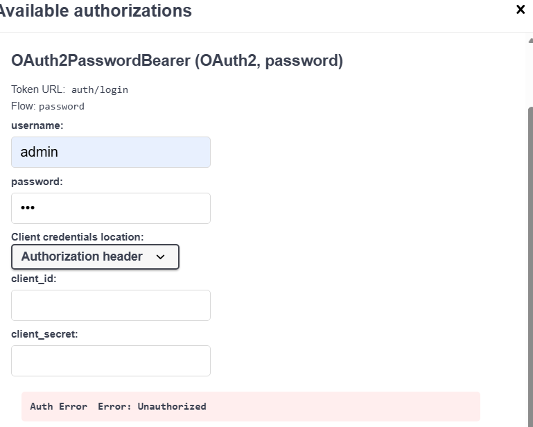 |
| Registro de un usuario nuevo (201) | 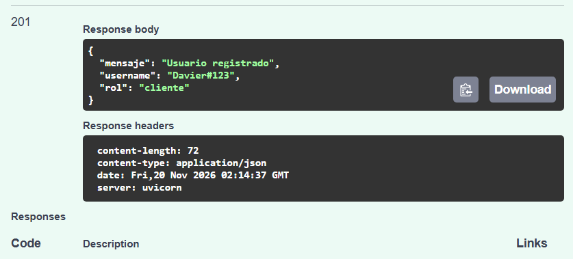 |
| Login del usuario recién registrado (200, token) | 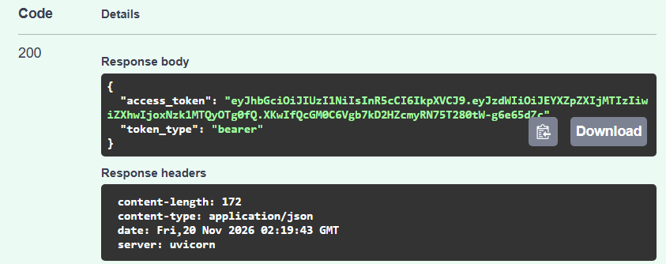 |
| PUT /productos/{id} sin token (401) | 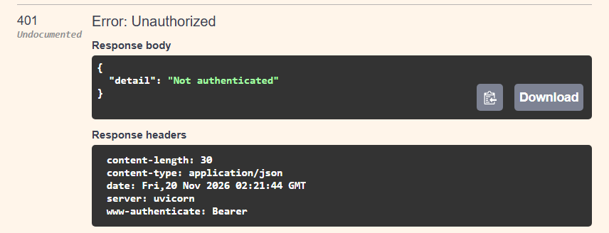 |
| PUT /productos/{id} con token (200) | 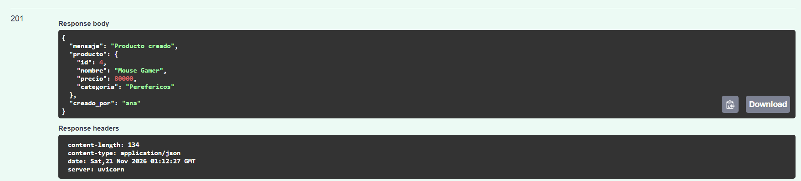 |
| POST /categorias sin token (401) | 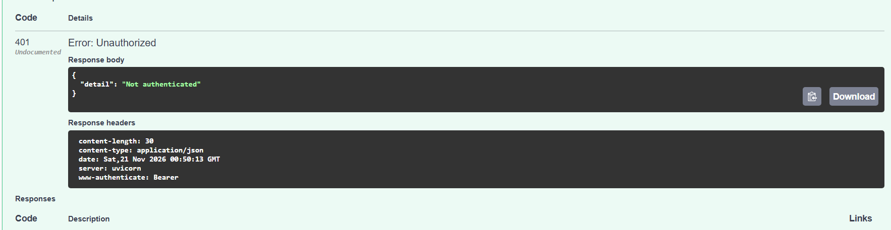 |
| ana crea una categoría (201) | 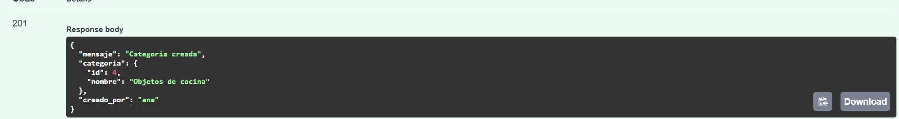 |
| ana intenta borrar una categoría (403) | 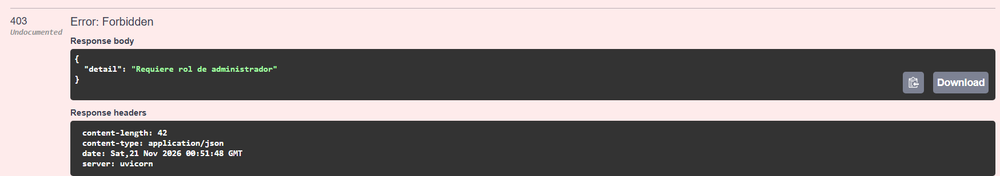 |
| admin borra una categoría (200) | 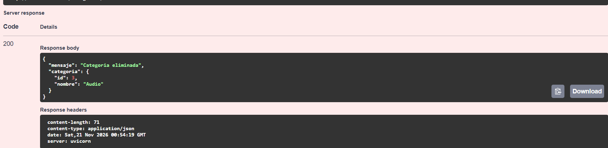 |

## Referencias

- Ramírez, S. (2024). *FastAPI: Security*. https://fastapi.tiangolo.com/tutorial/security/
- Ramírez, S. (2024). *FastAPI: OAuth2 with password (and hashing), Bearer with JWT tokens*. https://fastapi.tiangolo.com/tutorial/security/oauth2-jwt/
- PyJWT. *Documentación oficial*. https://pyjwt.readthedocs.io/
- OWASP. *Password Storage Cheat Sheet*. https://cheatsheetseries.owasp.org/cheatsheets/Password_Storage_Cheat_Sheet.html
- matiussw. (s. f.). *Ecommerce-Api-Python* [Repositorio de GitHub]. https://github.com/matiussw/Ecommerce-Api-Python
