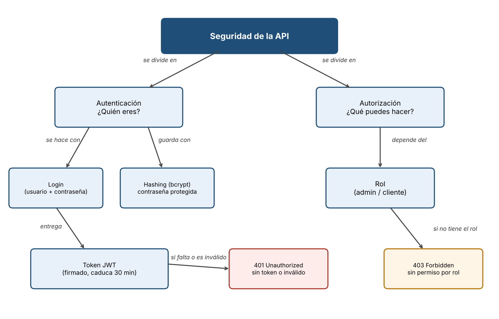
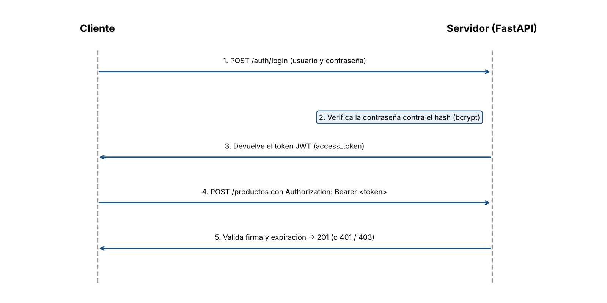

# Guía 3: seguridad de la API

**Evidencias:** GA3-AA1-EV01, GA3-AA1-EV02, GA3-AA2-EV03 y GA3-AA3-EV04.

## Qué se aprendió

- **Autenticación** ¿quién eres? (login) y **autorización** ¿qué puedes hacer? (rol). Primero se autentica y después se autoriza.
- **Hashing con bcrypt:** se guarda el hash de la contraseña, nunca la contraseña. Del hash no se puede recuperar la original, pero sí comprobar si una contraseña coincide.
- **Token JWT:** texto firmado con una clave secreta que guarda el usuario y su expiración (30 minutos). Evita enviar la contraseña en cada petición.
- **`Depends`:** una dependencia es una función que se ejecuta antes del endpoint; si lanza un error, el endpoint no corre.
- **401** (no autenticado) frente a **403** (sin permiso).



## Flujo



1. El usuario envía usuario y contraseña a `POST /auth/login`.
2. El servidor verifica la contraseña contra el hash. Si coincide, devuelve un token JWT.
3. El cliente envía el token en la cabecera `Authorization: Bearer <token>`.
4. El servidor comprueba firma y expiración, identifica al usuario y ejecuta la operación.
5. Si el token falta o es inválido responde 401; si el rol no alcanza, 403.

## Cómo está construido

| Pieza | Dónde | Para qué |
|-------|-------|----------|
| `hashear_password`, `verificar_password` | `seguridad.py` | Hashing con bcrypt |
| `crear_token` | `seguridad.py` | Genera el JWT con `sub` y `exp` |
| `obtener_usuario_actual` | `seguridad.py` | Valida el token y devuelve el usuario (401) |
| `requerir_admin` | `seguridad.py` | Exige rol admin (403) |
| `/auth/login`, `/auth/registro`, `/auth/yo` | `routers/auth.py` | Entregar el token, registrar clientes y consultar al usuario actual |

Proteger un endpoint es agregar un parámetro:

```python
@router.post("", status_code=201)
def crear_producto(datos: ProductoEntrada,
                   usuario: dict = Depends(seguridad.obtener_usuario_actual)):
    ...

@router.delete("/{producto_id}")
def eliminar_producto(producto_id: int,
                      admin: dict = Depends(seguridad.requerir_admin)):
    ...
```

Notas de seguridad:

- `/auth/registro` siempre crea usuarios con rol `cliente` y nunca devuelve la contraseña. La contraseña admite máximo 72 caracteres (límite de bcrypt).
- En un proyecto real la `SECRET_KEY` va en una variable de entorno y los usuarios en una base de datos (Guía 4).

## Reglas de acceso

- `GET` de productos y categorías → públicos.
- `POST` y `PUT` → cualquier usuario autenticado.
- `DELETE` → solo rol admin.

## Pruebas que deben salir

| Prueba | Usuario | Código |
|--------|---------|--------|
| POST /productos | Sin token | 401 |
| POST /auth/login con contraseña mala | n/a | 401 |
| POST /productos | ana | 201 (`creado_por: ana`) |
| PUT /productos/{id} | ana | 200 |
| DELETE /productos/{id} | ana | 403 |
| DELETE /productos/{id} | admin | 200 |
| POST /categorias | Sin token | 401 |
| POST y PUT /categorias | ana | 201 y 200 |
| DELETE /categorias/{id} | ana | 403 |
| DELETE /categorias/{id} | admin | 200 |
| POST /auth/registro y luego login | usuario nuevo | 201 y 200 |

## Evidencias

Capturas en [`capturas/guia-3`](../capturas/guia-3/). Nombres sugeridos:
`01_sin_token_401.png`, `02_ana_crea_201.png`, `03_ana_borra_403.png`, `04_login_fallido_401.png`,
`05_registro_201.png`, `06_put_protegido.png`, `07_admin_borra_200.png`, `08_categorias_401.png`,
`09_categorias_201.png`, `10_categorias_403.png`, `11_categorias_admin_200.png`.
